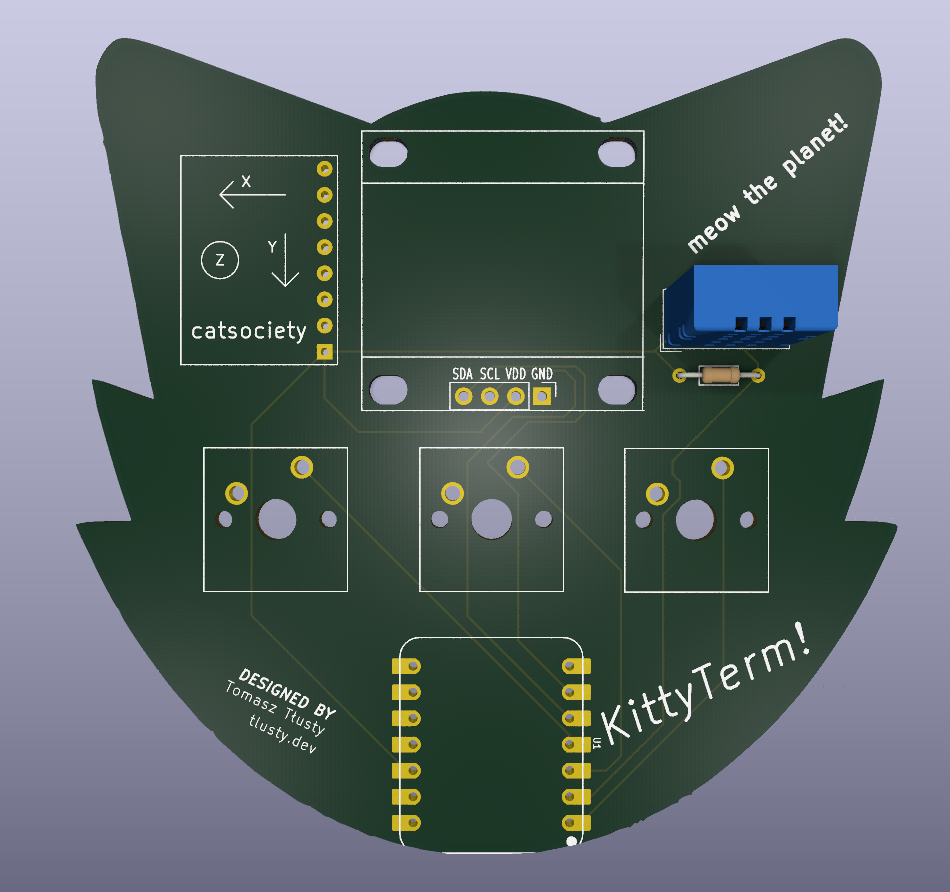

# KittyTerm

KittyTerm is a tiny motion-controlled digital pet: basically a desktop Tamagotchi with a 3-button control scheme and motion sensing. You can interact with it both by physically moving the board and by using the onboard push buttons.

## What it is

KittyTerm is designed to sit on your desk, show its personality on a small OLED display, and react to how you handle it. Tilting, shaking, and checking in on your pet are all part of the experience.

The board includes a Seeed XIAO ESP32-C3 microcontroller, an SSD1306 OLED display, an MPU6050 motion sensor, a DHT11 environmental sensor, and three push buttons in a compact, USB-powered PCB design built around beginner-friendly through-hole soldering.

## Why?

This project was created for the week 1 beginner tutorial for [halflife](https://halflife.hackclub.com/)!

## Project status

The PCB design, renders, and starter firmware are included here. The program features an animated pet with a tilt- and button-controlled radial menu, live environmental stats, persistent memory, and shake reactions.

## Software

[`Firmware/`](Firmware/) contains a single-file, non-blocking (`millis()`-based) sketch for the **Seeed XIAO ESP32-C3**, compatible with both Arduino IDE and PlatformIO.

### Key Firmware Features

- **Three Screen Views (`View` State Machine)**:
  - **`PET_VIEW`**: Renders a custom 32x32 1-bit `PROGMEM` sprite on a 128x64 SSD1306 OLED (`0x3C`). The pet wanders across the screen and plays procedural animations for jumping, running laps, sleeping (with floating `z`s), and emitting hearts.
  - **`MENU_VIEW`**: A 4-sector radial menu (`NAP`, `PLAY`, `FEED`, `PET`). Opening the menu records the board's current tilt angle as a zero-point calibration, turning the MPU6050 (`0x68`) into a smoothed air-mouse cursor with a configurable center deadzone.
  - **`STATS_VIEW`**: Displays 0–100 stat bars for `JOY`, `ENERGY`, and `FULL`, alongside live ambient temperature and humidity readings polled from the DHT11 sensor.
- **Hybrid 3-Button & Motion Controls** (with 30 ms software debouncing):
  - **Button 1 (`GPIO 4` / `D2`)**: Opens the radial menu, confirms the highlighted action, or cancels if pressed while in the center deadzone.
  - **Button 2 (`GPIO 5` / `D3`)**: Toggles between the main pet screen and the stats screen.
  - **Button 3 (`GPIO 2` / `D0`)**: Cycles through the 4 radial menu options when the menu is open (allowing full navigation even without tilting), triggers a quick `PET` reaction on the main screen, or exits the stats screen.
  - **Shake Detection**: Continuously computes the 3D acceleration vector magnitude from the MPU6050. Shaking the board past the gravity threshold wakes the pet from naps, triggers a wiggle animation, and boosts `JOY`.
- **Persistent Flash Storage (`Preferences.h`)**:
  - Automatically saves `joy`, `energy`, and `fullness` values to the ESP32-C3's Non-Volatile Storage (NVS) after every action or shake so your pet's progress is kept across power cycles.
- **Beginner-Friendly Customization**:
  - All GPIO pin mappings, I2C addresses, starting stats, menu reactions, MPU6050 axis orientation (`SWAP_MPU_AXES`), and sprite bitmaps are grouped in the `BEGINNER SETTINGS` section at the top of the file.

### Required Libraries

- `Adafruit GFX Library`
- `Adafruit SSD1306`
- `Adafruit MPU6050` (with `Adafruit Unified Sensor` and `Adafruit BusIO`)
- `DHT sensor library`

## Repository contents

- `PCB/` - KiCad source files and fabrication exports
- `Images/` - front and back PCB renders
- `Week 1 Guide.md` - project guide material
- `Firmware/` - Arduino IDE / PlatformIO starter sketch